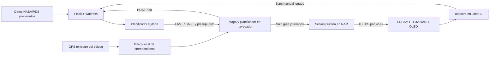

# Arquitectura y mantenimiento

[Índice](../README.md) · [API](API.md) · [Especificaciones](ESPECIFICACIONES.md).

## Componentes y flujo

La voz se sintetiza en el navegador del celular. Las coordenadas terrestres no pasan al canal de guía. El ESP no ejecuta SciPy, no descarga un mapa global ni interpreta geometría 3D: recibe la indicación actual.

## Distribución del código

| Archivo/directorio | Responsabilidad |
| --- | --- |
| `iniciar.py` | CLI local, entorno aislado, dependencias, validación de datos y arranque |
| `server.py` | Entrada Render/producción, `PORT`, `RUTA_DATA_DIR`, Waitress de un hilo |
| `relay/app.py` | Recursos web, terreno, rutas, manifest y copia de bitácoras |
| `relay/planet.py` | Selección de región por solicitud y limpieza de temporales |
| `relay/field.py` | Catálogo científico por región y scripts de campo permitidos |
| `relay/navigator.py` | Sesiones temporales autenticadas, validación, frescura y paquete ESP |
| `pipeline/terrain.py`, `roughness.py`, `visualization.py` | Preparación/derivados del relieve y capas |
| `pipeline/mission.py` | Objetivo científico y supuestos explícitos de movilidad/equipo |
| `pipeline/fetch_chemistry.py` | Importación reproducible de química PDS, emparejamiento y hashes |
| `pipeline/route.py`, `cost.py` | Grafo dirigido, costes, rutas y métricas |
| `pipeline/scenario.py` | Supuestos y presupuesto EVA educativo |
| `pipeline/planet.py` | Lectura MOLA, proyección, muestreo y atlas |
| `pipeline/fetch_jezero.py`, `fetch_glen.py`, `fetch_mola.py` | Importadores reproducibles de datos oficiales |
| `pipeline/build.py`, `manifest.py`, `tiles.py`, `synth.py` | Build de terreno/manifiesto, PNG/BMP 320×240 y demo |
| `web/app.js` | Estado de misión, selección, peticiones de planificación y tarjetas |
| `web/terrain.js` | Mapa/malla, interacción, seguimiento y conexión entre vistas |
| `web/planet.js` | Globo y selección de regiones |
| `web/science.js` | Capas, procedencia, compatibilidad de foto y perfil |
| `web/mission.js`, `chemistry.js` | Objetivo, notas propias, exclusiones y capa/detalle de química observada |
| `web/points.js` | Catálogo, conversión coordenadas/rejilla y puntos personales |
| `web/navigation.js` | Maniobras y posición a lo largo de una ruta, sin DOM |
| `web/guidance.js` | Presentación de maniobras y síntesis de voz |
| `web/streetview.js` | Geometría y render WebGL de superficie |
| `web/actors.js`, `texture.js` | Dos personajes y proyección de imagen sobre triángulos |
| `web/operations.js` | Escenario, desvíos y recálculo del tramo restante |
| `web/navigator.js` | GPS local, anclaje, seguimiento real, vista de bolsillo y publicación al ESP |
| `assets/` | Datos preparados, imágenes, catálogos y procedencia |
| `firmware/psion-micor-spaceapps/` | Integración actual con la base ESP32 suministrada |
| `firmware/psion_micor_stable/` | Variante anterior conservada; no es el nuevo receptor TFT |
| `tests/`, `relay/tests/` | Pruebas Python, JavaScript y compilación nativa de núcleos C++ |
| `reference/` | Material de referencia/diseño histórico; contrastar con especificaciones actuales |

## Ciclo de misión

1. El cliente selecciona región; el servidor resuelve el terreno de esa solicitud.
2. El cliente obtiene manifiesto, malla visual y catálogos. A/B/paradas se guardan en memoria del navegador.
3. Un POST incluye rejilla, escenario, límite de pendiente y exclusiones. Python calcula sobre arrays completos; el muestreo gráfico no entra en el cálculo.
4. Se devuelven FAST/SAFE, regreso, métricas y presupuesto. No se sobrescribe el manifiesto precalculado.
5. Mapa, perfil, superficie, personajes y voz consumen el mismo recorrido. El avance puede ser simulado o seguir GPS anclado.
6. Recálculo conserva hogar y puntos pendientes. Un error elimina la ruta válida del nuevo cálculo y pausa; no usa una ruta de otra región como sustituto.
7. Exportación descarga una copia JSON, sin crear una base de datos de misiones.

Las revisiones de solicitudes evitan que una respuesta antigua reemplace una misión editada o una región recién seleccionada. El estado del navegador no es un registro compartido de servidor.

## Aislamiento de regiones y memoria

Jezero usa el directorio configurado. Glen usa su paquete separado. MOLA se lee mediante memoria mapeada; cada coordenada produce una ventana local, con caché limitada a ocho regiones. Los archivos temporales asociados a una solicitud se eliminan al finalizar. No se cambia un directorio global de trabajo para todos los visitantes.

Los arrays de exclusión se calculan sin sobrescribir los originales. NoData se preserva y se excluye tanto del dibujo como del tránsito. Los `.npy` se leen sin pickle. El despliegue de un hilo limita cálculos simultáneos y memoria, a costa de poder retrasar otras peticiones.

## Persistencia y canales distintos

- **Versión de datos:** `assets` y manifiestos v3 en Git.
- **Personalización web:** `localStorage` por ámbito geográfico; sin cuentas ni sincronización.
- **Misión/anclaje:** memoria de la página; el GPS se solicita por una acción del usuario y se detiene al ocultarla.
- **Guía ESP:** última publicación por sesión, en RAM, sin historial; tokens distintos de lectura/escritura y caducidad fija.
- **Bitácora:** archivos LittleFS del ESP y copia de sincronización en el servidor. Este endpoint legado no está cubierto por las credenciales del navegador.

El manifiesto de bitácora, las sesiones de guía y los JSON exportados son canales diferentes. No deben documentarse como una única sincronización automática.

## Integración embebida

`forest.ino`, `bitacora_core.h`, `eva_budget.h` y `mision_map_contract.h` se conservan byte a byte de las entregas aportadas. El sketch principal añade los enganches append-only de ROVER; los manifiestos de hashes conservan ambas procedencias. Se modifica el espacio Misión en `spaceapps_apps.h` y se añaden:

- `navigator_core.h`: parser acotado, paquete y estado/frescura, sin dependencia de Arduino.
- `navigator_link.h`: tarea HTTPS, vinculación, proveedor EVA y adaptación al shell.
- `navigator_tft.h`: presentación 320×240, iconos y texto acotado; no modifica las helpers de otras apps.
- `navigator_ca.h`: raíces de confianza GTS para el transporte TLS.

El worker de red no dibuja en pantalla; comparte una instantánea protegida y la UI la consume. El proveedor registrado con `mision::setMapProvider` respeta unidades en segundos, variantes 0/1 y capacidad de ocho paradas. No se cambia la electrónica del shell ni se eliminan sus aplicaciones heredadas.

## Criterios de diseño

Se aplican responsabilidades separadas, contratos pequeños y reutilización de rutas/escenarios entre vistas: SOLID, DRY, KISS y YAGNI como criterios de mantenimiento, no como certificación automática. La interfaz actual usa módulos JavaScript y algunos globales compartidos; no es una arquitectura de clases totalmente desacoplada. Mantener los cambios en el componente correspondiente y evitar abstracciones sin un uso concreto.

No se incorpora un framework de frontend, base de datos o servicio de voz externo para tareas que resuelve la implementación existente. Un futuro despliegue con varios procesos requeriría compartir sesiones; no debe activarse escalado horizontal suponiendo que la RAM actual ya lo hace.

## Verificación y operación

- Python: rutas, presupuesto, NoData, coordenadas/proyecciones, importación, servidor, regiones, restricciones, sesiones y persistencia de bitácora.
- JavaScript/Node: maniobras, superficie, capas, globo, cambios de región, coordenadas, GPS/anclaje/rumbo/frescura y carga del frontend.
- C++ nativo: parser, capacidades del contrato y renderer TFT, con pruebas de texto largo/límites y sanitizadores.
- Arduino CLI: compilación real del sketch ESP32 completo, no solo de una maqueta de la pantalla.
- HTTP público: disponibilidad de recursos y enlace autenticado de guía comprobados; no equivale a probar una placa.

Para cambios solo de documentación basta contrastar código, enlaces y ejemplos; no se necesitan nuevos tests que repliquen párrafos. Para modificar planificación o firmware, ejecutar las pruebas pertinentes de esos módulos y recompilar cuando corresponda. La prueba física de GNSS del celular, Wi-Fi/TLS de la placa, TFT/OLED, audio y batería sigue siendo manual.

## Módulo 3 ROVER

`pov_core.h` y `pov_contract.h` definen la simulación/contrato geométrico; `rover_app.h` implementa su ciclo de vida y lectura de mosaicos, y `pov_render.h` recorta la geometría al visor. La nueva app usa LittleFS `data/pov` con archivos preparados por `pipeline.pov_tiles`. Se integró sin reemplazar Misión ni la guía de bolsillo. El canal de guía contiene tiempos/indicaciones y no es un proveedor automático de geometría. [Diseño, pruebas y carga de datos](MODULO_ROVER_ESP32.md).
